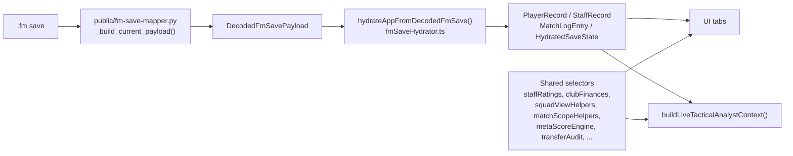

# FM27 data parity contract map

Date: 26 November 2026
Roadmap: R04
Status: complete for the current core surfaces

The UI and the Analyst must answer the same question with the same number. This map is the contract between them: each important value has one decoder source, one hydrator or shared selector, and one UI and Analyst consumer.

Read it before changing a decoder field, a hydrator, a selector, or a prompt block. If a row cannot be filled on both sides, the value is either deliberately UI-only or a gap. Both are recorded below.

## How to read the table

- **Decoder** is the key in the payload returned by `_build_current_payload()` in `public/fm-save-mapper.py`. Raw CA/PA and hidden personality values are scrubbed before the payload leaves the decoder.
- **Hydrator / selector** is the TypeScript field or shared function that turns decoded data into the app value. A selector named here must be imported by both sides, not reimplemented in the prompt.
- **UI** is the component that shows the value to the user.
- **Analyst** is the block in `buildLiveTacticalAnalystContext()` that carries the value. `Import prompt` means the value appears only in `hydratedFmSave.analystPromptContext` from `hydrateAppFromDecodedFmSave()`.
- **Status** is one of:
  - `Shared selector`: the same function is imported by the UI and the Analyst.
  - `Shared state`: the Analyst reads the hydrated field or label built by the same selector as the UI.
  - `UI only`: deliberately not sent to the live Analyst; the reason is recorded.
  - `Import prompt`: present only in the first-sync prompt, not the live context.
  - `Gap`: a known mismatch, with an owner.

## The contract

| # | Group | Value | Decoder | Hydrator / selector | UI | Analyst | Status |
| --- | --- | --- | --- | --- | --- | --- | --- |
| 1 | Save | In-game date | `meta.gameDateDmy`, `meta.gameDateIso` | `HydratedSaveState.saveDateLabel` | Hub header, Staff, Matches | `club_snapshot` | Shared state |
| 2 | Save | Club name | `meta.clubName` | `decoded.meta.clubName` | Hub header, Transfers, Staff | `club_snapshot` | Shared state |
| 3 | Save | Manager name | `meta.managerName`, `governance.managerContract.managerName` | `decoded.meta.managerName`, `ClubGovernanceState.managerContract` | Hub header, Club Governance | `club_snapshot`, `governance_promises` | Shared state |
| 4 | Save | FM build and patch compatibility | `meta.build`, `meta.patchCompatibility` | `decoded.meta.patchCompatibility` | Patch banner, Live FM Save Proof | `club_snapshot` does not carry the build | Gap: R11 |
| 5 | Save | Save file name and size | `meta.saveName`, `meta.fileName`, `meta.fileSizeMb` | `decoded.meta` | Upload and Live FM Save Proof | Import prompt header | Import prompt |
| 6 | Save | Squad pool counts | `players[]`, `players[].teamSlot` | `countSquadPool`, `describeSquadPool` | Hub header, Squad header | `club_snapshot` | Shared selector |
| 7 | Save | League position, record, points | `leagueStanding.*`, `playedMatches[]` | `computeCompetitiveSummary`, `leagueRecordLabel`, `leagueStandingLabel` | Hub KPI, Squad header | `club_snapshot` | Shared selector |
| 8 | Save | Next fixture and opponent | `upcomingFixtures[]`, `leagueStanding.nextOpponentStanding` | `nextFixtureLabel`, `decoded.leagueStanding.nextOpponentStanding` | Hub header | `club_snapshot` | Shared state |
| 9 | Save | League table | `leagueStanding.rows`, `leagueStanding.top5` | `decoded.leagueStanding` | Hub | `club_snapshot` | Shared state |
| 10 | Save | Competition registration rules | `competitionRules.*` | `hydratedFmSave.competitionRules` | Transfers | `club_snapshot` | Shared state |
| 11 | Save | Division wage and attribute benchmarks | `divisionBenchmarks.*` | `hydratedFmSave.divisionBenchmarks` | Transfers | `club_snapshot` | Shared state |
| 12 | Save | Job Centre vacancies | `jobVacancies[]` | `normalizeJobVacancy` | Staff | `club_snapshot` | Shared selector |
| 13 | Save | Club facilities | `facilities.*` | `decoded.facilities` | Live FM Save Proof | Import prompt | Import prompt |
| 14 | Squad | Player UID, name, shirt number | `players[].uid`, `name`, `shirtNumber` | `PlayerRecord` | Squad, Player detail | `squad_profiles` | Shared state |
| 15 | Squad | Position, secondary positions, IP/OOP roles | `players[].position`, `primaryPosition`, `secondaryPositions` | `inferFm27Roles`, `PlayerRecord.position` | Squad, Player detail | `squad_profiles` | Shared state |
| 16 | Squad | Position familiarity (PosFam) | `players[].positionRatings` | `formatCompactPositionRatings` | Squad, Player detail | `squad_profiles` | Shared selector |
| 17 | Squad | Age and nationality | `players[].age`, `nation` | `formatAge`, `formatNation` | Squad, Player detail | Age in `squad_profiles`; nationality is UI-only | Shared selector for age; UI only for nation |
| 18 | Squad | Ability and potential stars | `players[].abilityStars`, `potentialStars`; raw `ca`/`pa` are scrubbed | `getPlayerStars` in the hydrator | Squad, Player detail | `squad_profiles` | Shared state |
| 19 | Squad | Weekly wage | `players[].wagePw` | `formatWeeklyWage` | Squad, Player detail, Staff cards | `squad_profiles` | Shared selector |
| 20 | Squad | Contract expiry | `players[].expires`, `contractExpiryMonths` | `formatContractExpiry`, `formatShortContractExpiry` | Squad, Player detail | `squad_profiles` | Shared selector |
| 21 | Squad | Contract clauses and promised playing time | `players[].contractDetails` | `resolveSquadStatusFromPlayingTime`; `contractClauseBlock` | Player detail | `squad_profiles` status; import prompt clauses | Shared state plus import prompt |
| 22 | Squad | Market value | `players[].marketValue`, `marketValueState` | `PlayerRecord.marketValue`, `marketValueState` | Player detail, Transfers | Transfer audit and shortlist blocks | Shared state |
| 23 | Squad | Apps, minutes, average rating | `players[].apps`, `minutes`, `rating` | `hasPlayerMatchStats` | Squad, Player detail | `squad_profiles` | Shared selector |
| 24 | Squad | Goals, xG, assists, xA, per-90 rates | `players[].goals`, `xG`, `xGPer90`, `assists`, `xA`, `xAPer90` | `PlayerRecord` fields | Squad, Player detail | `squad_profiles` | Shared state |
| 25 | Squad | Defensive and possession per-90 rates | `players[].drbPer90`, `prPassesPer90`, `hdrPct`, `intPer90`, `tckPct` | `PlayerRecord` fields | Player detail, Knowledge Base | Not in the live squad profile | UI only: context budget |
| 26 | Squad | Attributes | `players[].attributes` | `PlayerRecord.attributes` | Player detail, Knowledge Base | `squad_profiles` compact P/S/J/Pa/F/T/D/W line | Shared state: Analyst gets the decision attributes only |
| 27 | Squad | Condition and sharpness | `players[].condition`, `sharpness` | `clampConditionSharpness` | Squad, Player detail | `squad_profiles` condition tag | Shared state |
| 28 | Squad | Preferred foot and height | `players[].preferredFoot`, `leftFoot`, `rightFoot`, `heightCm` | `inferPreferredFoot` | Player detail | Not in the live squad profile | UI only: context budget |
| 29 | Squad | Personality and morale | `players[].personalityLabel`, `morale`, `hiddenPersonality` (scrubbed) | `inferPersonalityLabel` | Player detail, Knowledge Base | Recruitment character labels only; squad personality is UI-only | UI only |
| 30 | Squad | Squad status | `players[].contractDetails.promisedPlayingTime` | `resolveSquadStatusFromPlayingTime` | Squad, Player detail | `squad_profiles` standing | Shared state |
| 31 | Squad | Squad unit and loan flag | `players[].teamSlot`, `onLoan` | `resolveSquadUnit`, `PlayerRecord.onLoan` | Squad, Player detail | `squad_profiles` unit tag; loan flag in transfer advice | Shared state |
| 32 | Squad | Traits and scout badges | `players[].traits`, `scoutBadges` | `resolveScoutBadges` | Player detail | `squad_profiles` B/T tags | Shared state |
| 33 | Squad | Last-5 form and season history | `playerMatchStats`, `playerSeasonHistory` | `calculateLast5Form`, `PlayerRecord.last5Form` | Squad, Player detail | `squad_profiles` L5 tag | Shared state |
| 34 | Squad | Injuries | `activeInjuries[]` | `isPlayerActivelyInjured`; `PlayerRecord.status` | Squad, Player detail | `club_snapshot`, `squad_profiles` INJ tag | Shared state |
| 35 | Squad | Suspensions | `activeSuspensions[]` | `bansByUid`; `PlayerRecord.activeSuspensions` | Squad, Player detail | `club_snapshot`, `squad_profiles` BAN tag | Shared state |
| 36 | Squad | Best Fit % and role suitability | Derived from attributes and `positionRatings` | `analyzePlayerCard` | Player detail, Squad cards | `squad_profiles` BF tag | Shared selector |
| 37 | Squad | Meta current and potential score | Derived from player attributes | `evaluatePlayerMetaScore` | Meta badge, Player detail | `ai_research` | Shared selector |
| 38 | Squad | Transfer verdict and action plan | Derived from squad, wages, contracts, benchmarks | `buildSquadTransferAudit` | Squad, Transfers | `transfers_action_plan`, `transfers_depth` | Shared selector |
| 39 | Staff | Staff identity, role, age, nationality | `staff[].uid`, `name`, `role`, `age`, `nation` | `StaffRecord` | Staff directory, Staff detail | `backroom_staff` | Shared state |
| 40 | Staff | Secondary job | `staff[].secondaryJob` | `StaffRecord.secondaryJob` | Staff card and detail | `backroom_staff` | Shared state |
| 41 | Staff | Weekly wage | `staff[].wagePw` | `StaffRecord.wagePw` | Staff card and detail | `backroom_staff` payroll | Shared state |
| 42 | Staff | Contract expiry | `staff[].expires` | `isStaffContractExpiringSoon`, `formatContractExpiry` | Staff KPI and cards | `backroom_staff` expiring list | Shared selector |
| 43 | Staff | Department and headline rating | `staff[].attributes` | `getStaffHeadlineDisplay`, `classifyStaffDepartment` | Staff cards and detail | `backroom_staff` department ratings | Shared selector |
| 44 | Staff | Unified training and department matrix | `staff[].attributes`, `staff[].role` | `buildUnifiedStaffMatrix` | Staff Training & Dept Matrix tab | `backroom_staff` department leads | Shared selector |
| 45 | Staff | Weekly staff payroll | `staff[].wagePw` | `computeWeeklyStaffPayroll`, `formatWeeklyStaffPayroll` | Staff KPI strip, Hub Finances | `backroom_staff` | Shared selector |
| 46 | Staff | Preferred Job Affinity ratings | `staff[].jobRatings` | `formatStaffJobRatings`, `PREFERRED_JOB_AFFINITY_CAPTION` | Staff detail modal only | `backroom_staff` one-line summary | Shared selector; UI shows all six, Analyst gets a summary |
| 47 | Staff | Staff attributes | `staff[].attributes` | `StaffRecord.attributes` | Staff detail modal | Not sent raw | UI only: Analyst gets ratings, not the attribute table |
| 48 | Staff | Board and executive classification | `staff[].role` | `resolveStaffJobEligibility`, `classifyStaffDepartment` | Staff detail | Department ratings | Shared selector |
| 49 | Staff | Average staff rating | `staff[].attributes` | `computeStaffKpiSummary` | Staff KPI strip | Not quoted by the Analyst | UI only: no duplicate average in the prompt |
| 50 | Finances | Bank balance | `finances.balance`, `monthlyFinances[].balance`, `meta.balance` | `resolveCanonicalBalanceNum` | Hub Finances | `club_snapshot` | Shared state |
| 51 | Finances | Latest monthly net | `monthlyFinances[].netCashflow` | `buildClubFinancesPanel` | Hub Finances | `club_snapshot` runway and net | Shared state |
| 52 | Finances | Financial runway | `monthlyFinances[]` | `calculateFinancialRunway` | Hub Finances | `club_snapshot` runway | Shared state |
| 53 | Finances | Player Wage Bill (canonical) | `finances.wagePayrollWeekly` | `buildClubFinancesPanel`, `resolveCanonicalClubFinances`, `formatWageComplianceSummary`, `wageComplianceLabel` | Hub Finances, Transfers | `club_snapshot` | Shared state |
| 54 | Finances | Player wage budget and headroom | `finances.wageBudgetWeekly` | `classifyWageCompliance`, `formatWageComplianceSummary` | Hub Finances, Transfers | `club_snapshot` | Shared state |
| 55 | Finances | Squad wage subtotal | `players[].wagePw` | `computeSquadWageSubtotal` | Hub Finances | `journey_report` uses its own sum | Gap: R10 |
| 56 | Finances | Sponsorship deals | `sponsorships[].name`, `type`, `annualValue`, `expires`, `dates_reordered` | `filterUsableSponsorshipDeals`, `buildSponsorshipPanelRows` | Hub Finances | `club_snapshot` sponsorship summary | Shared selector |
| 57 | Finances | Transfer budget remaining | `finances.transferBudgetRemaining` | `resolveCanonicalClubFinances.transferBudgetRemaining` | Transfers | `recruitment` budget verdicts | Shared state |
| 58 | Finances | Scouting budget | `meta.scoutingBudget`, `meta.scoutingBudgetRemaining` | Typed on `decoded.meta`; no selector | Not shown | Not sent | Gap: R07 |
| 59 | Matches | Result and scoreline | `playedMatches[].result`, `score` | `MatchLogEntry` | Matches | `recent_matches` | Shared state |
| 60 | Matches | Competition and season scope | `playedMatches[].competition`, `dateIso`, `dateDmy` | `classifyMatchEntryBucket`, `classifyMatchCompetitionBucket`, `deriveFootballSeasonLabel` | Matches filters and KPI scope | `recent_matches` | Shared selector |
| 61 | Matches | xG for and against | `playedMatches[].xGFor`, `xGAgainst` | `MatchLogEntry` | Matches | `recent_matches` | Shared state |
| 62 | Matches | Possession, shots, CCC, pass completion | `playedMatches[].possession`, `shotsFor`, `shotsAgainst`, `cccFor`, `cccAgainst`, `passCompletion` | `MatchLogEntry` | Matches | Import prompt only | Import prompt |
| 63 | Matches | PPG, win rate, points | Derived from scoped matches | `summarizeMatchesByScope`, `computeCompetitiveSummary` | Matches KPI | `club_snapshot` record | Shared selector |
| 64 | Matches | Momentum and season chronicle | Derived from matches | `buildMatchMomentumSummary`, `buildSeasonChronicle` | Matches | Not sent | UI only: context budget |
| 65 | Matches | Post-match debrief | Derived from a match | `buildDeterministicPostMatchDebrief` | Matches | Not sent | UI only: Analyst writes its own debrief |
| 66 | Recruitment | Target identity, position, age | `recruitmentTargets[].uid`, `name`, `primaryPosition`, `age` | `RecruitmentTarget` | Transfers | `recruitment` | Shared state |
| 67 | Recruitment | Current club, contract, free or loan | `recruitmentTargets[].currentClub`, `expires`, `contractExpiryMonths`, `isFreeAgent`, `isLoanCandidate` | `RecruitmentTarget` | Transfers | `recruitment` | Shared state |
| 68 | Recruitment | Transfer value and wage demand | `recruitmentTargets[].transferValue`, `currentWagePw`, `demandedWageEur` | `RecruitmentTarget` | Transfers | `recruitment` | Shared state |
| 69 | Recruitment | Target attributes and position ratings | `recruitmentTargets[].attributes`, `positionRatings` | `RecruitmentTarget` | Transfers | `recruitment` | Shared state |
| 70 | Recruitment | Personality, badges, traits | `recruitmentTargets[].personality`, `scoutBadges`, `traits` | `RecruitmentTarget` | Transfers | `recruitment` | Shared state |
| 71 | Recruitment | Fit % and budget verdict | Derived from target, squad, benchmarks | `evaluateInGameShortlist` | Transfers | `recruitment` | Shared selector |
| 72 | Recruitment | Shortlist origin and count | `recruitmentTargets[]`, `shortlistOrigin` | `RecruitmentTarget`, `evaluateInGameShortlist` | Transfers | `recruitment` | Shared state |
| 73 | Tactics | Formation, slots, IP/OOP roles | `tactics[]`, `selections` | `TacticSlotAssignment`, `buildLastMatchTacticBlueprint` | Tactics, Pitch Builder | `last_tactic`, `war_room_xi` | Shared state |
| 74 | Tactics | Team instructions | `tactics[].teamInstructions` | `TacticTeamInstructions` | Tactics | `last_tactic` | Shared state |
| 75 | Tactics | Last-match blueprint | `tactics[]`, `playedMatches[]` | `buildLastMatchTacticBlueprint` | Last Match Tactic card | `last_tactic` | Shared selector |
| 76 | Tactics | War Room and full-fit XI | Derived from squad, roles, fitness | `solveBestXi` | Tactics, Pitch Builder | `war_room_xi`, `full_fit_xi` | Shared selector |
| 77 | Tactics | Set-piece specialist rankings | Derived from attributes | `buildDynamicSetPieceRoutines` | Set Pieces | `set_pieces` | Shared selector |
| 78 | Tactics | Squad planner depth | `squadPlanner[]` | `resolveSquadPlannerSlotMeta` | Squad planner charts | `squad_planner` | Shared selector |
| 79 | Tactics | Training plan | `training`, `selections` | Decoded records | Set Pieces and Training | Not sent | UI only: R13 may add a decoded training block |
| 80 | Tactics | Mentoring groups | `mentoring[]` | `decoded.mentoring` | Live FM Save Proof count | Import prompt | Import prompt |
| 81 | Tactics | Pitch builder overrides | UI state, not decoded | `CustomSlotOverride` | Pitch Builder | `war_room_xi` override block | Shared state |
| 82 | Governance | Manager contract and job security | `governance.managerContract.*` | `buildClubGovernanceState` | Club Governance | `governance_promises` | Shared selector |
| 83 | Governance | Board confidence | `governance.boardConfidence.*` | `buildClubGovernanceState` | Club Governance | `governance_promises` | Shared selector |
| 84 | Governance | Supporter confidence | `governance.supporterConfidence.*` | `buildClubGovernanceState` | Club Governance | `governance_promises` | Shared selector |
| 85 | Governance | Board objectives | `governance.boardObjectives[]` | `buildClubGovernanceState` | Club Governance | `governance_promises` | Shared selector |
| 86 | Governance | Club promises | `governance.clubPromises[]` | `buildClubGovernanceState` | Club Governance | `governance_promises` | Shared selector |
| 87 | Governance | Playing-time promise audit | Derived from promises and minutes | `buildClubGovernanceState` | Club Governance | `governance_promises` | Shared selector |
| 88 | Governance | Extraction manifest, warnings, fast sync | `extractionManifest.*`, `warnings[]`, `fastSync` | `decoded.extractionManifest`, `mergedWarnings` | Live FM Save Proof, Club Governance | Import prompt reader notes; live context gets `fastSync` only through the header | Import prompt |
| 89 | Governance | Binary forensics and step timings | `binaryForensics.*`, `stepTimingsMs` | `decoded.binaryForensics`, `decoded.stepTimingsMs` | Live FM Save Proof | Not sent | UI only: diagnostics |
| 90 | Governance | Real-save fingerprint manifest | Test fixture, not a save field | `tests/fixtures/real-saves/manifest.json` | Not shown | Not sent | Test-only: R03 |
| 91 | Finances | What-if projection (balance, monthly net, runway, wage headroom) | `monthlyFinances[].netCashflow`, `finances.balance`, `finances.wagePayrollWeekly`, `finances.wageBudgetWeekly` via `buildClubFinancesPanel` | `projectFinanceScenario` (`src/utils/financeScenarios.ts`) | Hub Finances — What if… | Not sent | UI only: user-entered deltas are not save data, and the prompt keeps quoting the decoded snapshot, not a projection |
| 92 | Transfers | Contract expiry centre rows, months left, weekly wage at risk, plan totals | `players[].contractExpiry` / `staff[].expires` via `evaluateTransferAudit` and `staffContractDaysRemaining` | `buildContractExpiryCentre` (`src/utils/contractExpiryCentre.ts`), `suggestedDecisionForVerdict` | Transfers — Expiring soon — players and staff | Same expiry facts as the prompt; the user's renew/sell/release plan is not sent | UI only for the plan: it is a user intention in `fm27_contract_plan_v1`, not a decoded field |
| 93 | Staff | Org chart department, head, headcount and weekly wage per department | `staff[].role` / `staff[].wagePw` via `classifyStaffDepartment`, `getStaffHeadlineDisplay`, `staffContractDaysRemaining` | `buildStaffOrgChart` (`src/utils/staffOrgChart.ts`) | Staff — Org Chart | Same staff facts as the prompt; the head is not sent | UI only for the head: FM27 stores a job title, not a reporting line, so the head is an inference and the Analyst must not be told it as fact |

## Shared selectors the test enforces

`src/utils/dataParityContract.test.ts` checks that the following selectors are still used by both a UI file and an Analyst file. It also checks that this document names every selector and that the referenced files exist. The test is a tripwire, not a substitute for tracing a new field by hand.

| Selector | UI owner | Analyst owner |
| --- | --- | --- |
| `formatWeeklyWage` | `src/components/PlayerDetailModal.tsx` | `src/utils/tacticalAnalystContext.ts` |
| `formatContractExpiry` | `src/components/PlayerDetailModal.tsx` | `src/utils/tacticalAnalystContext.ts` |
| `formatAge` | `src/components/PlayerDetailModal.tsx` | `src/utils/tacticalAnalystContext.ts` |
| `hasPlayerMatchStats` | `src/utils/squadViewHelpers.ts` (shared row builder) | `src/utils/tacticalAnalystContext.ts` |
| `describeSquadPool` | `src/components/AutoSyncWorkspace.tsx` | `src/utils/tacticalAnalystContext.ts` |
| `computeCompetitiveSummary` | `src/App.tsx` | `src/utils/tacticalAnalystContext.ts` |
| `classifyMatchEntryBucket` | `src/components/MatchLogArchive.tsx` | `src/utils/tacticalAnalystContext.ts` |
| `analyzePlayerCard` | `src/components/PlayerDetailModal.tsx` | `src/utils/tacticalAnalystContext.ts` |
| `rankRolesForPlayer` / `RankedRoleFit` weights | `src/components/PlayerDetailModal.tsx` | `src/utils/tacticalAnalystContext.ts` squad BF% from the same `bestIpRole` |
| `evaluatePlayerMetaScore` | `src/components/PlayerDetailModal.tsx` | `src/utils/fmfShortlistExporter.ts` |
| `buildSquadTransferAudit` | `src/components/RecruitmentWorkspace.tsx` | `src/utils/tacticalAnalystContext.ts` |
| `buildDynamicSetPieceRoutines` | `src/components/SetPiecesAndTraining.tsx` | `src/utils/tacticalAnalystContext.ts` |
| `buildLastMatchTacticBlueprint` | `src/components/LastMatchTacticBlueprintCard.tsx` | `src/utils/tacticalAnalystContext.ts` |
| `buildClubGovernanceState` | `src/App.tsx` | `src/utils/tacticalAnalystContext.ts` |
| `resolveSquadPlannerSlotMeta` | `src/components/charts/SquadScatterAndPlannerCharts.tsx` | `src/utils/tacticalAnalystContext.ts` |
| `normalizeJobVacancy` | `src/components/StaffDirectory.tsx` | `src/utils/tacticalAnalystContext.ts` |
| `isStaffContractExpiringSoon` | `src/components/StaffDirectory.tsx` | `src/utils/tacticalAnalystContext.ts` |
| `getStaffHeadlineDisplay` | `src/components/StaffDirectory.tsx` | `src/utils/tacticalAnalystContext.ts` |
| `buildUnifiedStaffMatrix` | `src/components/StaffDirectory.tsx` | `src/utils/tacticalAnalystContext.ts` |
| `PREFERRED_JOB_AFFINITY_CAPTION` | `src/components/StaffDetailModal.tsx` | `src/utils/tacticalAnalystContext.ts` |
| `computeStaffKpiSummary` | `src/components/StaffDirectory.tsx` | `src/utils/tacticalAnalystContext.ts` uses `formatWeeklyStaffPayroll` |
| `buildClubFinancesPanel` | `src/components/AutoSyncWorkspace.tsx` | `src/utils/tacticalAnalystContext.ts` uses `buildSponsorshipPanelRows` |
| `buildSponsorshipPanelRows` | `src/components/AutoSyncWorkspace.tsx` through the panel | `src/utils/tacticalAnalystContext.ts` |
| `resolveSaveCompatibility` | `src/components/AutoSyncWorkspace.tsx` → `SaveCompatibilityPanel` | `src/utils/tacticalAnalystContext.ts` `save_compatibility` |
| `mergeAnalystCitations` | `src/components/AutoSyncWorkspace.tsx` Grounded in footer | `server/prompts.ts` citation law + `sourceCitations[]` |

## Known gaps

These are real mismatches or unused fields. They are not fixed in R04 because R04 is the map, not the repair. Each has an owner in the roadmap.

R10 closed the journey-report wage gap: `diffSaveHistoryPoints` now uses `computeSquadWageSubtotal`, records missing-wage counts, and both the Journey panel and the Analyst line say when the total covers known wages only.

R11 closed the build-compatibility gap: `resolveSaveCompatibility` gives the Hub Data tab and the Analyst the same verified, supported, untested or unsupported answer, with the changed fields and the behavior for that save.

| Gap | Current state | User-visible consequence | Owner |
| --- | --- | --- | --- |
| Scouting budget | `meta.scoutingBudget` and `meta.scoutingBudgetRemaining` are decoded and typed, but no selector or surface reads them. | The user cannot see the scouting budget in the Hub or ask the Analyst about it. | R09 follow-up |
| Full match detail in the live Analyst | `recent_matches` carries result and xG; possession, shots, CCC, and pass completion stay in the Matches tab and the import prompt. | A question about a match's possession or chance creation can get a shallower answer than the Matches tab shows. | R13 |
| Training plan in the live Analyst | The decoder returns `training`, but the live context has no training block. | The Analyst cannot quote the save's current training schedule; it can only recommend one. | R13 |

## Deliberate omissions

These are UI-only by design. They are not gaps, and the Analyst should not invent them.

| Value | Why it stays out of the live prompt |
| --- | --- |
| Nationality, preferred foot, height, morale, personality for every squad player | The live prompt has a hard character budget. The decision attributes, form, role fit, and contract facts matter more per player. |
| Full per-90 defensive and possession table | The Squad and Player detail surfaces hold the detail; the Analyst gets the decision attributes and season production. |
| Six individual Preferred Job Affinity values per staff member | The Analyst gets the one-line affinity summary and the caption that says the values are preference, not ability. Sending all six for every staff member would crowd out the department ratings and payroll. |
| Staff attribute table | The Analyst gets the department rating and matrix lead, which is the user-facing conclusion. |
| Average staff rating | A single average is easy to misread across a mixed backroom. The Analyst quotes department ratings and payroll instead. |
| Momentum, season chronicle, and post-match debrief | These are presentation layers over the same matches; the Analyst gets the scoped record and recent results. |
| Contract horizon summary | The Analyst gets the expiry lists and transfer action plan, which use the same advice rows. |
| Binary forensics, step timings, and the real-save fingerprint manifest | Diagnostics and CI proof, not football decisions. |

## Changing a field

1. Change the decoder only with a Python fixture and expectation.
2. Add or update the TypeScript type and the hydrator in the same change.
3. Put the calculation or formatting in a selector under `src/utils/` if more than one surface needs it.
4. Import that selector in the UI component and in `tacticalAnalystContext.ts`. Do not reformat the value inside the prompt.
5. Add the row to this table, including the decoder key, selector, UI owner, Analyst block, and status.
6. Add or update a test that exercises the real selector. If the value is UI-only, record why here.
7. Run `npx tsc --noEmit && npm run lint && npm test && npm run build && npm run ui:audit`.

## Verification

- `src/utils/dataParityContract.test.ts` checks the shared-selector tripwires, the required table sections, and the roadmap link.
- Existing parity tests cover the individual domains: `financesStaffOverhaul.test.ts`, `phase5AnalystAndConsistency.test.ts`, `staffRatings.test.ts`, `clubFinances.test.ts`, and `fmSaveHydrator.test.ts`. `crossTabConsistency.test.ts` checks staff ratings, staff payroll, finance totals, squad pool counts, expiry windows and journey wage totals across Hub, Squad, Staff and Analyst. `fm27SaveCompatibility.test.ts` checks the matrix, the UI panel, the Analyst block and the unsupported-save message. `playerCardAnalysis.test.ts` checks role weights, thresholds, missing attributes and the nearest alternative. `analystCitations.test.ts` checks the prompt law, schema field, inline extraction, persisted citations, offline citations and the response footer.
- R03's real-save regression suite covers the decoder fingerprint separately.
